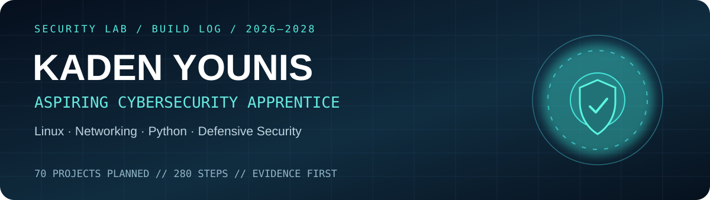
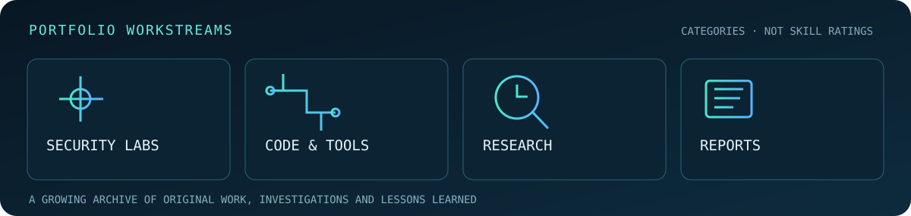

**Kaden Younis · Sixth-form student · Cybersecurity, systems and software**

## About me

I'm Kaden, a sixth-form student studying A-level Maths, Physics and Computer Science.

I've always liked figuring out how technology works. Cybersecurity is where I'm putting most of that interest now. I'm learning Linux, networking and Python, and spending time in labs to get better at understanding systems rather than just following commands.

This GitHub is where I keep my projects, notes and the things I try along the way. Some will be small experiments; others will become bigger projects as I learn more.

## Projects & notes

| Area | What's here |
|:--|:--|
| [Projects & labs](https://github.com/kadencybsec/cybersecurity-projects) | Hands-on security labs, scripts and applications |
| [Project index](https://github.com/kadencybsec/cybersecurity-projects/blob/main/PORTFOLIO.md) | A closer look at finished projects |
| [Research](https://github.com/kadencybsec/cybersecurity-projects/tree/main/research) | Security topics and investigations |
| [Learning log](https://github.com/kadencybsec/cyber-learning-log) | Linux, networking, Python and CTF notes |

## Currently exploring

- **Home lab:** [B06 — Personal cybersecurity lab](https://github.com/kadencybsec/cybersecurity-projects/tree/main/projects/beginner/B06). My first planned setup includes virtual machines, isolated networking and snapshots.
- **Linux and networking:** Getting more comfortable using the terminal and explaining what commands actually do.
- **Security labs:** Working through introductory Hack The Box material and documenting the concepts I understand.

## A project I set myself

I have a [70-project cybersecurity learning plan](https://github.com/kadencybsec/cybersecurity-projects/blob/main/docs/roadmap.md) running alongside my other interests and projects. It gives me a way to explore different areas of security while I'm in sixth form.

Progress shown here is for this particular project list only. I'll keep adding other work separately.

---

Cybersecurity · Linux · Networking · Python · Projects & technical notes

